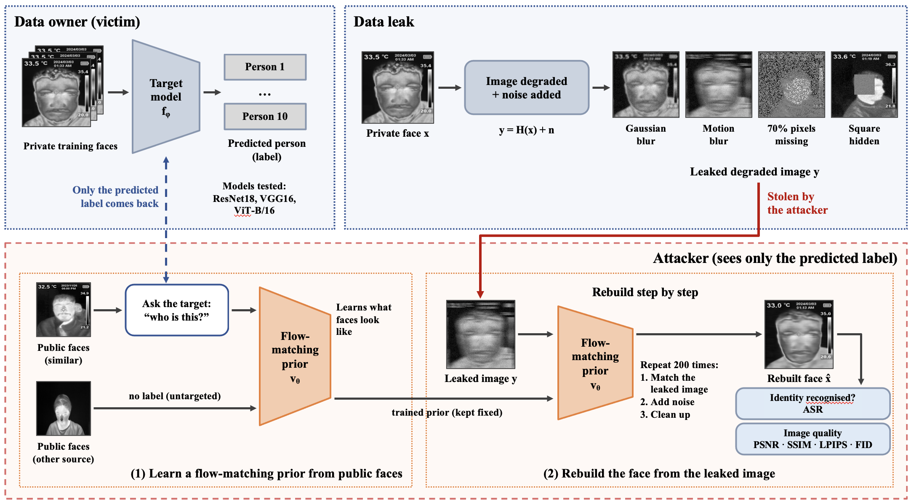

# ThermalFlow-MI: Label-Only Model Inversion Attacks on Thermal Face Recognition with Flow Matching Priors
<p align="center">
  
  <br>
  <em>Figure 1: Overview of ThermalFlow-MI. A flow matching prior trained on target-labelled auxiliary thermal faces
  drives a PnP-Flow reconstruction of a leaked, degraded private image.</em>
</p>

A framework for reconstructing private thermal faces from a leaked, degraded copy (blurred or partly masked) using
only the top-1 labels of the deployed target classifier (no gradients, no confidence scores). The target classifiers
are ResNet18, ResNet50, VGG16 and ViT-B/16, trained on CFTD, Charlotte-ThermalFace and ThermVision-DB. The attack
runs in two settings and with two kinds of prior:

1. **Untargeted** — an unconditional flow matching prior; success means the classifier recognises the person again.
2. **Targeted** — a class-conditional prior, trained on auxiliary faces labelled by the target classifier.
3. **In- / out-of-distribution priors** — the prior is trained on public faces of the same dataset, or of another
   dataset whose people do not appear in the private data.

## Table of Contents

- [Overview](#overview)
- [Pipeline](#pipeline)
- [Threat Model](#threat-model)
- [Requirements](#requirements)
  - [Datasets](#datasets)
- [Module map](#module-map)
- [Installation](#installation)
- [Usage](#usage)
  - [Train target models](#train-target-models)
  - [Train the prior](#train-the-prior-stage-1)
  - [Run the attack](#run-the-attack-stage-2)
  - [Evaluate](#evaluate-a-run)
  - [Defences](#defences)
  - [Reproduce the paper](#reproduce-the-paper)
- [Settings](#settings)
- [Output](#output)
- [Evaluation Metrics](#evaluation-metrics)
- [License](#license)
- [Citation](#citation)

## Overview

The attack has two stages:

1. **Prior.** The attacker labels public auxiliary thermal faces with the target classifier and trains a flow
   matching prior on them (conditional flow matching with minibatch OT coupling). The prior is class-conditional
   for the targeted attack and unconditional for the untargeted one.
2. **Reconstruction.** PnP-Flow alternates a gradient step on the data term with a denoising step by the prior,
   starting from the degraded copy. Only forward passes of the prior are needed.

```
auxiliary images ──► target classifier (top-1 labels) ──► flow matching prior v_θ(x, t, c)
                                                                    │
leaked copy y = Hx + n ──► PnP-Flow: z = x − γ∇ℓ(y; x),  x = D_t(t z + (1−t) ε) ──► reconstruction x̂
```

Four degradations are supported: Gaussian blur, motion blur, box inpainting and random inpainting. Four defences
are implemented: negative label smoothing (NLS), BiDO-HSIC, DP-SGD and image immunization.

## Pipeline
```
Full Dataset (per dataset: CFTD, Charlotte-ThermalFace, ThermVision-DB)
    ├── 70% → train (private data)
    │       ├── 100% ──► trains the target classifier (ResNet18, ResNet50, VGG16, ViT-B/16)
    │       └── degraded copy y = Hx + n ──► attacked by ThermalFlow-MI
    │
    ├── 10% → test
    │       └── 100% ──► test accuracy of the classifier, choice of PnP step sizes
    │
    └── 20% → auxiliary (attacker's public data)
            └── labelled by the target classifier (top-1)
                      ↓
                 Flow matching prior (in-distribution)
                      ↓
                 PnP-Flow reconstruction
                      ↓
                 Reconstructions ──► Evaluate (attack accuracy, PSNR, SSIM, LPIPS, FID, KID)

Out-of-distribution prior: trained on another dataset
(Charlotte-ThermalFace for CFTD; CFTD for the other two).
```

## Threat Model

The attacker:

- has one degraded copy of a private training image, such as a blurred or partly occluded frame;
- can query the deployed classifier for top-1 labels only;
- has public thermal faces of the same kind (in-distribution) or of other people (out-of-distribution).

The attack never uses the private images themselves. The private images and the clean test images are used only
to measure how well the attack works.

## Requirements
- torch>=2.1
- torchvision>=0.16
- torchdiffeq==0.2.5
- POT==0.9.7.post1 (exact optimal transport for the minibatch OT coupling)
- numpy
- scipy
- scikit-learn
- scikit-image
- lpips==0.1.4
- Pillow
- PyYAML
- tqdm
- opacus==1.5.2 (only for the DP-SGD defence)

### Datasets

The datasets are public but are not redistributed here. Download them from their authors and place them under
`data/` (or edit `data_root` in `configs/datasets/*.yaml`).

| Dataset | Type | Used as | Folder | Expected layout |
|---|---|---|---|---|
| Comprehensive Facial Thermal Dataset (CFTD) | Thermal face recognition | private data; OOD prior data for the other two | `data/CFTD` | `<identity 1..10>/<palette>/*.bmp` |
| Charlotte-ThermalFace | Thermal face recognition | OOD prior data for CFTD; private data in its own experiments | `data/Charlotte-ThermalFace` | `S<k>/*.jpg` |
| ThermVision-DB | Thermal face recognition | private data | `data/ThermVision-DB` | `<Female\|Male> Subjects/Set 2 Cropped Facial Expressions/Subject-<k>/…/*.png` |

`splits/<dataset>.csv` lists every image with its identity and split (`train` 70%, `test` 10%, `auxiliary` 20%),
with paths relative to the dataset folder.

## Module map

| File | Contents |
|---|---|
| `thermalflow_mi/config.py` | Dataset configs and default paths |
| `thermalflow_mi/attack/unet.py` | UNet velocity field and its class-conditional version |
| `thermalflow_mi/attack/labeling.py` | Labels the auxiliary data with the target classifier (label-only access) |
| `thermalflow_mi/attack/flow_matching.py` | Trains the prior: conditional flow matching with minibatch OT coupling |
| `thermalflow_mi/attack/pnp_flow.py` | PnP-Flow reconstruction and the observation model `y = Hx + σn` |
| `thermalflow_mi/attack/run.py` | Attacks a set of images; saves images and a manifest |
| `thermalflow_mi/degradations/gaussian_blur.py` | σ = 1, 61 × 61 kernel, noise 0.05 |
| `thermalflow_mi/degradations/motion_blur.py` | 15 px, 0°, noise 0.05 |
| `thermalflow_mi/degradations/box_inpainting.py` | 40 × 40 centre box, noise 0.05 |
| `thermalflow_mi/degradations/random_inpainting.py` | 70% of pixels missing, noise 0.01 |
| `thermalflow_mi/defenses/nls.py` | Negative label smoothing |
| `thermalflow_mi/defenses/bido.py` | BiDO-HSIC |
| `thermalflow_mi/defenses/dp_sgd.py` | Differentially private training |
| `thermalflow_mi/defenses/immunization.py` | Perturbation of the released image against the attacker's solver |
| `thermalflow_mi/metrics/` | `accuracy.py`, `psnr.py`, `ssim.py`, `lpips.py`, `fid.py`, `kid.py`, `inception.py` (FID InceptionV3) |
| `thermalflow_mi/target_models/` | Target classifier architectures (`factory.py`) and training (`train.py`) |
| `thermalflow_mi/data/` | Datasets, the 70/10/20 split, evaluation subsets |
| `thermalflow_mi/utils/` | Seeding, image I/O, manifests |
| `scripts/train_classifier.py` | Target classifiers, with or without a model-side defence |
| `scripts/train_prior.py` | Stage 1 of the attack |
| `scripts/attack.py` | Stage 2 of the attack |
| `scripts/immunize.py` | Crafts immunization perturbations |
| `scripts/evaluate.py` | Accuracy, PSNR, SSIM, LPIPS, FID, KID of a run |
| `scripts/make_splits.py` | Regenerates a split file |
| `experiments/` | One shell script per part of the paper |
| `configs/datasets/` | `cftd.yaml`, `charlotte.yaml`, `thermvision.yaml` |
| `splits/` | The train / test / auxiliary split of every dataset used in the paper |

## Installation
### 1. Clone the repository
```bash
git clone https://github.com/Trust-AI-ua/ThermalFlow-MI.git
cd ThermalFlow-MI
```
> [!NOTE]
> `data/`, `checkpoints/`, `results/`, `runs/` and `*.pt`/`*.pth`/`*.ckpt` are listed in the [gitignore](.gitignore)
> to keep datasets, trained models and attack outputs out of the repository.

### 2. Create a virtual environment (recommended)

```bash
conda create -n thermalflow python=3.10 -y
conda activate thermalflow
```
### 3. Install dependencies
```bash
pip install -r requirements.txt
```
### 4. Verify installation

```bash
python -c "import torch, torchvision, torchdiffeq, ot, lpips, sklearn, skimage, PIL, yaml; print('All dependencies OK')"
```

A CUDA GPU is strongly recommended. The experiments ran with PyTorch 2.13 and torchvision 0.28 on one GPU.
LPIPS, the ImageNet classifier weights and the FID Inception weights are downloaded on first use.

## Usage

All commands run from the repository root. Defaults are the paper's settings.

### Train target models
```bash
python scripts/train_classifier.py --dataset cftd --model resnet18
```

#### Arguments

| Argument | Default | Description |
|----------|---------|-------------|
| `--dataset` | **Required** | `cftd`, `charlotte`, `thermvision` or a config path |
| `--model` | **Required** | Target architecture (`resnet18`, `resnet50`, `vgg16`, `vit_b_16`, `vit_b_32`) |
| `--defense` | `none` | Model-side defence: `none`, `nls`, `bido`, `dp` |
| `--epochs` | `40` | Number of training epochs |
| `--nls-alpha` | `-0.05` | Final NLS smoothing factor |
| `--lambda-x` / `--lambda-y` | `5.0` / `50.0` | BiDO-HSIC weights |
| `--epsilon` | `None` | DP-SGD privacy budget (δ = 1e-5) |
| `--dp-lr` | `1e-2` | DP-SGD learning rate |
| `--dp-train` | `fc` | Layers trained under DP-SGD: `fc`, `layer4`, `all` |
| `--out` | `checkpoints/...` | Output folder |

### Train the prior (stage 1)
```bash
python scripts/train_prior.py --dataset cftd --distribution in_distribution --attack untargeted
python scripts/train_prior.py --dataset cftd --distribution in_distribution --attack targeted --target-model resnet18
```

#### Arguments

| Argument | Default | Description |
|----------|---------|-------------|
| `--dataset` | **Required** | Dataset name or config path |
| `--distribution` | **Required** | `in_distribution` or `out_of_distribution` |
| `--attack` | **Required** | `untargeted` (unconditional prior) or `targeted` (class-conditional prior) |
| `--target-model` | `None` | Classifier that labels the auxiliary data; required for `targeted` |
| `--classifier-checkpoint` | `None` | Override the classifier checkpoint path |
| `--label-source` | `target` | `target` (classifier top-1 labels) or `ground_truth` |
| `--label-noise` | `0.0` | Fraction of labels to corrupt (sensitivity study) |
| `--epochs` | `200` | Training epochs |
| `--batch-size` | `16` | Batch size |
| `--lr` | `1e-4` | Learning rate (Adam) |
| `--seed` | `0` | Random seed |
| `--tag` | `None` | Optional run tag |
| `--out` | `None` | Output folder |

### Run the attack (stage 2)
```bash
python scripts/attack.py --dataset cftd --distribution in_distribution --attack targeted \
    --target-model resnet18 --degradation gaussian_blur
```

#### Arguments

| Argument | Default | Description |
|----------|---------|-------------|
| `--dataset` | **Required** | Dataset name or config path |
| `--distribution` | **Required** | `in_distribution` or `out_of_distribution` |
| `--attack` | **Required** | `untargeted` or `targeted` |
| `--target-model` | `None` | Target classifier (required for `targeted`) |
| `--degradation` | **Required** | `gaussian_blur`, `motion_blur`, `box_inpainting`, `random_inpainting` |
| `--split` | `train` | Private images to attack |
| `--per-class` | `None` | Attack a seeded subset of N images per identity |
| `--subset-seed` | `0` | Seed of that subset |
| `--steps` | `200` | PnP-Flow steps N |
| `--num-samples` | `5` | Denoiser draws M per step |
| `--lr-pnp` / `--alpha` | per degradation | Step size η and exponent α of γ_n = η σ² (1 − t_n)^α |
| `--attack-sigma-blur` | `None` | Attacker's assumed Gaussian blur σ (mismatch study) |
| `--attack-motion-length` / `--attack-motion-angle` | `None` | Attacker's assumed motion blur (mismatch study) |
| `--prior` | `None` | Override the prior checkpoint path |
| `--unconditional-prior` | `False` | Use the unconditional prior in a targeted run (ablation) |
| `--delta` | `None` | Immunization perturbation (`delta.pt`) added to the released images |
| `--batch-size` | `4` | Batch size |
| `--seed` | `0` | Random seed |
| `--out` | `results/...` | Output folder |

### Evaluate a run
```bash
python scripts/evaluate.py results/cftd/in_distribution/targeted/resnet18/gaussian_blur/manifest.csv \
    --dataset cftd --classifiers resnet18 --per-class 20
```

#### Arguments

| Argument | Default | Description |
|----------|---------|-------------|
| `manifest` | **Required** | `manifest.csv` written by `attack.py` |
| `--dataset` | **Required** | Dataset name or config path |
| `--classifiers` | `[]` | Classifiers that score attack accuracy |
| `--checkpoint` | `None` | Override the classifier checkpoint path |
| `--per-class` | `None` | Evaluate N images per identity (the paper uses 20) |
| `--observed` | `False` | Score the degraded copies instead of the reconstructions (baseline) |
| `--resize` | `pil` | Resizing used before the classifier: `pil` or `tensor` |
| `--no-quality` | `False` | Accuracy only |
| `--kid` | `False` | Also compute KID |
| `--out` | `None` | Output path (default: `metrics.json` next to the manifest) |

### Defences

Model-side defences are set with `train_classifier.py --defense {nls,bido,dp}`. Image immunization is crafted
per released image and then passed to the attack:
```bash
python scripts/immunize.py --dataset cftd --distribution in_distribution --attack targeted \
    --target-model resnet50 --degradation gaussian_blur --per-class 20 --eps 8 --out runs/immun/gaussian_eps8
python scripts/attack.py --dataset cftd --distribution in_distribution --attack targeted \
    --target-model resnet50 --degradation gaussian_blur --per-class 20 \
    --delta runs/immun/gaussian_eps8/delta.pt --out runs/immun/gaussian_eps8/attack
```

`immunize.py` takes the arguments of `attack.py` plus:

| Argument | Default | Description |
|----------|---------|-------------|
| `--eps` | `8.0` | L∞ budget in 1/255 of the [0, 1] range |
| `--iters` | `60` | PGD steps |
| `--K` | `20` | PnP steps of the differentiable surrogate solver |
| `--chunk` | `20` | Images per crafting chunk |
| `--out` | **Required** | Output folder (`delta.pt`, `craft.json`) |

### Reproduce the paper

| Script | Part of the paper |
|---|---|
| `experiments/01_train_classifiers.sh` | Target classifiers |
| `experiments/02_main_results.sh [dataset]` | Main results: untargeted and targeted, ID and OOD priors, four degradations |
| `experiments/03_sensitivity.sh` | Sensitivity studies |
| `experiments/04_ablation.sh` | Ablations |
| `experiments/05_defenses.sh` | Defences |

## Settings

| | Value |
|---|---|
| Image size | 1 × 128 × 128, values in [−1, 1] |
| Prior | UNet (32 channels, multipliers 1/2/4/8, 6 residual blocks, attention at 16 and 8); Adam, lr 1e-4, batch 16, 200 epochs |
| PnP-Flow | N = 200 steps, M = 5 denoiser draws, γ_n = η σ² (1 − t_n)^α |
| η, α on CFTD | Gaussian 1.0, 0.1; motion 1.5, 0.01; box 0.5, 0.1; random 2.0, 0.01 |
| η, α on Charlotte, ThermVision | Gaussian and motion 1.5, 0.01; box 0.5, 0.1; random 2.0, 0.01 |
| Classifiers | ResNet18, ResNet50, VGG16, ViT-B/16 (ImageNet initialisation, one-channel input, 224 px); AdamW, lr 1e-4, 40 epochs |
| Evaluation subset | main tables: first 20 images per identity; ablation, sensitivity, defences: 20 per identity drawn with seed 0 (`--per-class 20`) |
| NLS | smoothing factor 0 for the first 20 epochs, then linearly to −0.05 |
| BiDO | λ_x = 5, λ_y = 50, HSIC on the four ResNet stages |
| DP-SGD | ε ∈ {1, 8, 50}, δ = 1e-5, clip 1, expected batch 256, lr 1e-2, head trained on the frozen ImageNet backbone |
| Immunization | ‖δ‖∞ ≤ 8/255 and 16/255, 60 PGD steps of size ε/8, surrogate solver with K = 20 steps |

## Output

An attack run writes:

```
results/<dataset>/<distribution>/<attack>/[<target-model>/]<degradation>/
├── original/         private images (for evaluation only)
├── observed/         degraded copies y = Hx + n
├── reconstructed/    reconstructions x̂
├── manifest.csv      one row per image
├── config.json       run configuration
└── metrics.json      written by evaluate.py
```

## Evaluation Metrics

| Metric | Description |
|---|---|
| **Attack accuracy** | Top-1 accuracy of a classifier on the reconstructions: the share of reconstructions recognised as the right person. |
| **PSNR** | Peak signal-to-noise ratio between reconstruction and private image. |
| **SSIM** | Structural similarity between reconstruction and private image. |
| **LPIPS** | Learned perceptual distance between reconstruction and private image. |
| **FID** | Fréchet distance between InceptionV3 features of reconstructions and private images. |
| **KID** | Kernel Inception distance (`--kid`). |

Higher **attack accuracy**, **PSNR** and **SSIM** indicate a stronger attack. Lower **LPIPS**, **FID** and **KID**
indicate reconstructions closer to the private images.

## License

MIT License

Copyright (c) 2026 Trust-AI-Lab@UA. See [LICENSE](LICENSE).

## Citation

If you use this code in your research, please cite:

```bibtex
@misc{ThermalFlow-MI,
  title  = {ThermalFlow-MI: Label-Only Model Inversion Attacks on Thermal Face Recognition with Flow Matching Priors},
  author = {Name},
  year   = {2026},
  url    = {https://github.com/Trust-AI-ua/ThermalFlow-MI}
}
```
